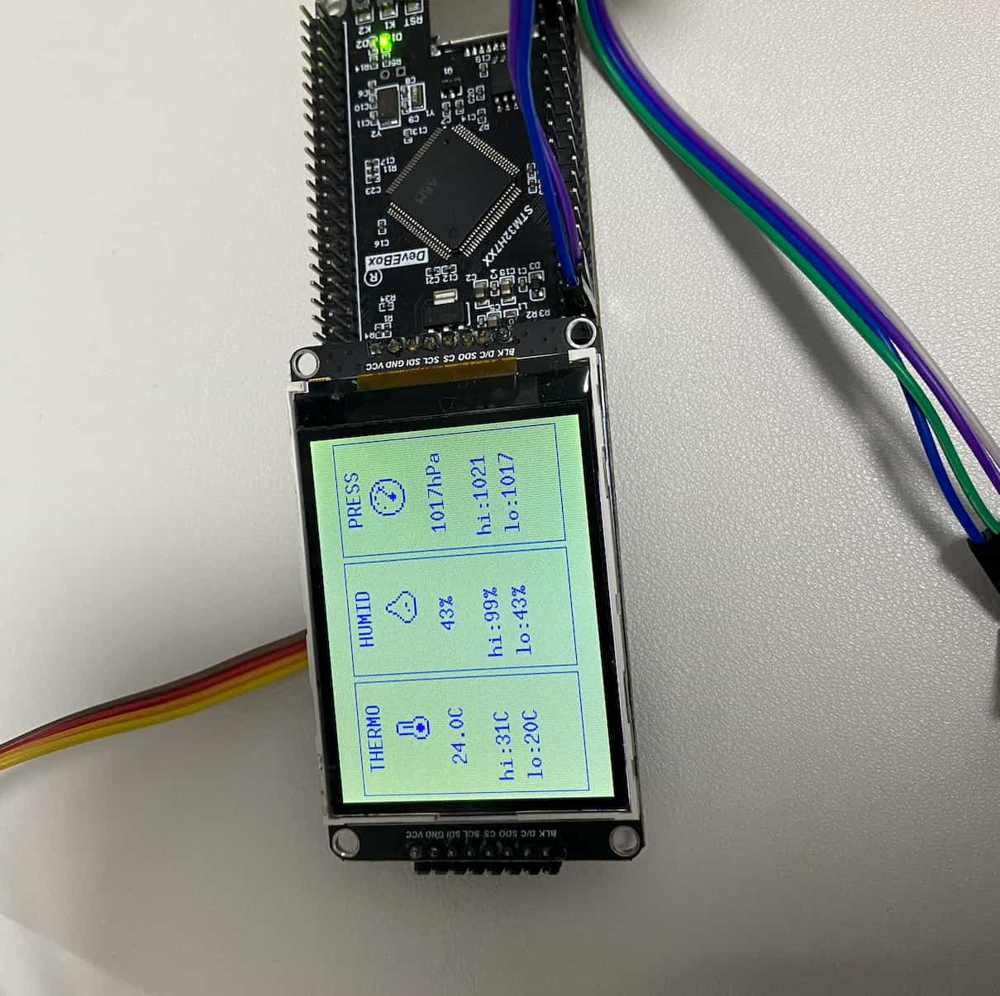

# STM32H750 Drivers

使用 Rust 编写的 STM32H750 单片机驱动集合，包含显示屏驱动（ILI9341）、多种传感器驱动（AHT20、BMP280、DHT11）和 UI 组件库。

## 示例展示



## 功能特性

- **实时监测**：定期读取 AHT20 温湿度传感器和 BMP280 气压传感器数据
- **可视化显示**：温度、湿度、气压分别以卡片形式在 ILI9341 屏幕上展示
- **状态指示**：LED 闪烁表示系统正常运行
- **高性能**：使用帧缓冲和局部刷新减少 SPI 传输
- **预留扩展**：包含 DHT11、NTC 等传感器的预留驱动
- **Wi-Fi 上报**：通过 ESP8266-01S 串口协处理器把传感器数据发布到局域网

## 硬件规格

| 项目 | 规格 |
|------|------|
| 主控芯片 | STM32H750VB |
| 系统时钟 | 400 MHz |
| 屏幕驱动 | ILI9341 |
| 分辨率 | 240x320 (横屏 320x240) |
| 颜色深度 | 16位 RGB565 |
| SPI 时钟 | 实际 50 MHz（请求 80 MHz，400 MHz 内核时钟 / 8）|

## 硬件连接

### I2C 传感器 (PB6/PB7)

| 传感器 | 引脚 | 连接 | 说明 |
|--------|------|------|------|
| AHT20 | PB7 | SDA | I2C 数据线 |
| AHT20 | PB6 | SCL | I2C 时钟线 |
| BMP280 | PB7 | SDA | I2C 数据线（共享）|
| BMP280 | PB6 | SCL | I2C 时钟线（共享）|

### ILI9341 TFT 屏幕 (SPI2)

| STM32H750 引脚 | 功能 | ILI9341 引脚 |
|---------------|------|-------------|
| PB15 | MOSI | SPI 数据输出 |
| PB13 | SCK | SPI 时钟 |
| PB12 | CS | 片选 |
| PB14 | MISO | SPI 数据输入 |
| PB1 | DC | 数据/命令选择 |
| PB0 | BLK | 背光控制 |

RC522 接线与读卡操作见 [RC522 读卡演示](docs/RC522_DEMO.md)。它使用 SPI1，
K1（PE3）上一页，K2（PC5）下一页，首尾循环；RST 保持复位；
原传感器卡片与配色保留，底栏继续显示刷新率。

### LED 状态指示

| 引脚 | 说明 |
|------|------|
| PA1 | 状态 LED（读取成功时闪烁）|

### ESP8266-01S 串口协处理器 (USART3)

| STM32H750 引脚 | ESP-01S 引脚 | 说明 |
|---------------|-------------|------|
| 3.3V | VCC | 电源 |
| 3.3V | EN | 使能拉高 |
| 3.3V | RST | 保持非复位 |
| 3.3V | GPIO0 | 正常启动拉高 |
| 3.3V | GPIO2 | 正常启动拉高 |
| GND | GND | 地 |
| PB10 | RX | STM32 TX -> ESP RX |
| PB11 | TX | STM32 RX <- ESP TX |

## 快速开始

### 前置要求

- Rust 工具链 (target: `thumbv7em-none-eabihf`)
- ST-Link V2/V3 调试器
- OpenOCD 工具

### 安装目标

```bash
rustup target add thumbv7em-none-eabihf
```

### 编译

```bash
make build
# 或
cargo build --release
```

### 烧录

```bash
make flash
```

### ESP8266 侧

当前显示/采集固件默认设置 `ESP8266_ENABLED = false`，跳过 ESP 连接和重试，避免其
阻塞采样更新。下述通信设计仍待与驱动核对，重新启用前需处理协议和阻塞问题。

ESP-01S 需要烧录自定义 `ota.ino`，它不是 AT 固件。当前工程按**文本行协议**与它通信，默认波特率是 `115200`。

串口协议示例：

```text
PING
WIFI?
SENSOR TEMP=25.3 HUM=61.2 PRES=1008.6
```

如果 ESP 已连上 Wi-Fi，最新传感器值会出现在：

```text
http://<esp-ip>/sensor
```

### GDB 调试

```bash
# 终端 1: 启动 OpenOCD 服务器
make debug

# 终端 2: 连接 GDB
arm-none-eabi-gdb target/thumbv7em-none-eabihf/release/stm32h750-drivers
(gdb) target remote :3333
(gdb) load
(gdb) break main
(gdb) continue
```

## 项目结构

```
src/
├── main.rs                  # 仅装配板级资源并启动应用
├── lib.rs                   # 固件、示例与测试共用的模块入口
├── application/
│   ├── runtime.rs           # 采集、动画、显示恢复的调度主循环
│   ├── navigation.rs        # 用户键消抖与演示页面选择
│   ├── rfid.rs              # 读卡、退避重试、最近成功 UID
│   ├── acquisition/
│   │   ├── mod.rs           # 持有驱动、记录、计数，提供采集与只读快照
│   │   └── record.rs        # 私有记录：校验、历史、极值和状态
│   ├── presentation.rs      # 采样/连接状态转为控件输入
│   ├── connection.rs        # 连接与上传流程状态
│   ├── scheduling.rs        # 周期期限和成功刷新率
│   └── config.rs            # 应用配置，ESP 默认关闭
├── drivers/
│   ├── aht20.rs / bmp280.rs # 基于 embedded-hal 的传感器协议
│   ├── rc522.rs             # 寄存器协议和 ISO14443A UID
│   └── display/
│       ├── mod.rs           # DisplayInterface 传输接口
│       ├── ili9341.rs       # 控制器协议、绘图和区域刷新
│       ├── pixel_pack.rs    # 裁剪、原生 u16 像素打包
│       ├── spi_transfer.rs  # 有超时的 8 位命令发送
│       ├── error.rs         # 显式传输错误
│       └── tests.rs         # 模拟传输接口的宿主机测试
├── bsp/
│   ├── board.rs             # STM32H750 时钟、引脚与外设所有权
│   ├── clock.rs             # TIM2 微秒时钟
│   ├── bounded_i2c.rs       # I2C 事务期限和恢复
│   ├── buttons.rs           # K1 / K2 上拉输入
│   ├── rc522.rs             # 独占 SPI1 / CS / RST 的有界交换
│   ├── adc_ntc.rs           # 预留 ADC 驱动
│   ├── profiler.rs          # 可选 DWT 计时
│   └── display/
│       ├── spi2.rs          # SPI2、CS/DC 和字长切换
│       ├── dma.rs           # DMA1 像素发送、超时和停流
│       ├── framebuffer.rs   # AXI SRAM 缓冲存储与一次性领取
│       └── bench.rs         # display-bench 特性下的实板测速
└── ui/
│   ├── screen.rs            # 控件布局、脏区域和显示适配
│   ├── sensor_format.rs     # 单位、占位符、状态文字
│   ├── status.rs            # 底栏状态与刷新率
│   ├── rfid_page.rs         # 独立读卡页面的文字输入与绘图
│   ├── flow_animation.rs    # 顶部动画
│   ├── theme.rs             # 原配色
│   └── widgets/             # 卡片等控件；各自定义输入类型

tests/
├── acquisition.rs           # 采集、状态转换与刷新协作
├── ui_rendering.rs          # 完整画面、局部刷新和动画回归
└── common/mod.rs            # 集成测试共享的模拟屏幕和布局
```

## 技术实现

### 帧缓冲机制

使用帧缓冲实现高效显示：

1. **内存布局**：240×320×2 字节 ≈ 150KB (AXISRAM)
2. **绘图流程**：在内存中绘制 → SPI2 16 位 DMA 传输 → 等待线路发送完毕（有超时）→ 屏幕显示。整行区域直接读取帧缓冲，窄区域使用 8KB 原生像素缓冲
3. **局部刷新**：仅重绘变化的卡片数字与状态，静态图标和边框保留；三张卡片同时更新的像素数据约减少 56%
4. **顶部动画**：流光往返移动，以 16.667ms 期限刷新 310×14 区域；底栏刷新率计入成功的动画更新，采样仍为 5 秒一次
5. **缓存与资源**：开启 I-Cache，保持 D-Cache 关闭；显示独占 DMA1，使用 stream 0 / DMAMUX request 40。后续开启 D-Cache 或共享 DMA1 前必须调整驱动

### 传感器轮询

- 使用 TIM2 硬件计时，每 5 秒调度一次采样；首帧立即采样
- AHT20 和 BMP280 借用同一条 I2C 总线，独立采集与重试
- 采集失败显示 `ERROR`；保留上次有效值时显示 `STALE`
- I2C 事务和 SPI 传输具有超时，错误会返回应用层
- `make test` 运行主机单元测试与集成测试，`make check-host` 同时检查测试代码；`make check` 检查 ARM 固件与格式
- 测试按模块归属组织，根目录 `tests/` 验证公开接口协作，详见 [测试说明](tests/README.md)

### 实板显示测速

`make bench-flash` 构建并烧录一次性测速固件，启动后测试绘图、整屏、三张卡片和顶部区域的传输，
结束后继续进入正常界面。测速期间不要打断点。另一个终端运行 `make debug`，完成后执行
`make bench-read` 读取 `status=2` 的结果；关闭 OpenOCD 后用 `make flash` 恢复普通固件。
结果中的时间单位为微秒，平均耗时为 `total_us / successes`，帧率为
`successes × 1,000,000 / total_us`。这是当前实现的吞吐基线，不是芯片极限或面板扫描频率。

## 开发文档

### 架构文档

- [架构设计](docs/ARCHITECTURE.md) - 系统整体架构
- [BSP 模块说明](src/bsp/README.md) - 板级硬件、接线、时钟与 DMA 的职责
- [Drivers 模块说明](src/drivers/README.md) - 器件协议、传输接口与驱动复用边界
- [Application 模块说明](src/application/README.md) - 采集所有权、流程调度与展示适配
- [UI 模块说明](src/ui/README.md) - 控件输入、绘制和刷新边界
- [帧缓冲指南](docs/learning/FRAME_BUFFER_GUIDE.md) - 帧缓冲实现原理
- [硬件连接](docs/learning/HARDWARE_CONNECTION.md) - 详细硬件连接说明

### 问题排查

- [疑难问题必看](docs/troubleshootings/) - 常见问题解决方案
  - [字符编码问题](docs/troubleshootings/CHARACTER_ENCODING_ISSUE.md)
  - [显示驱动问题](docs/troubleshootings/DISPLAY_DRIVER.md)
  - [延时和 I2C 问题](docs/troubleshootings/STM32H750_DELAY_AND_I2C_ISSUES.md)
  - [显示与采集可靠性、局部刷新](docs/troubleshootings/DISPLAY_AND_SENSOR_RELIABILITY.md)
  - [ESP8266-01S 串口协处理器模式](docs/troubleshootings/ESP8266_01S_UART_COPROCESSOR.md)

## 性能优化

- 局部更新卡片数字和状态，减少 SPI 数据量；像素通过 DMA1 发送
- 实板 50MHz SPI：整屏传输由 129.09ms 降至 24.58ms（约 5.25 倍），详见[测速与踩坑记录](docs/troubleshootings/DISPLAY_AND_SENSOR_RELIABILITY.md#14-dma-像素传输与实板恢复验证2026-10-11)
- 帧缓冲避免频繁 SPI 通信
- 优化传感器读取间隔

## 许可证

MIT License

## 参考资料

- [ILI9341 数据手册](https://cdn-shop.adafruit.com/datasheets/ILI9341.pdf)
- [STM32H7 参考手册](https://www.st.com/resource/en/reference_manual/dm00176879.pdf)
- [embedded-graphics 文档](https://docs.rs/embedded-graphics/)
